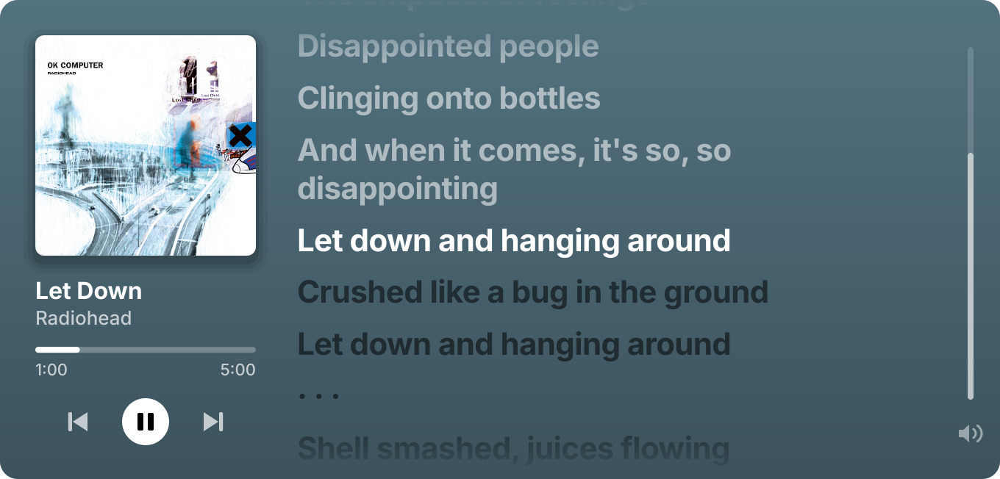
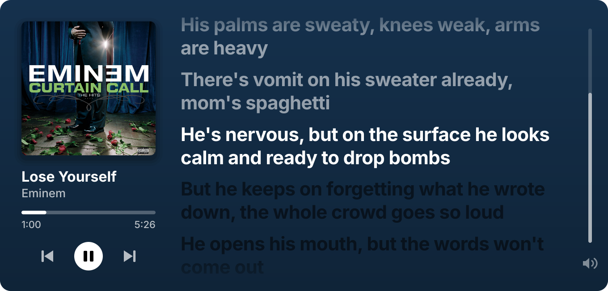
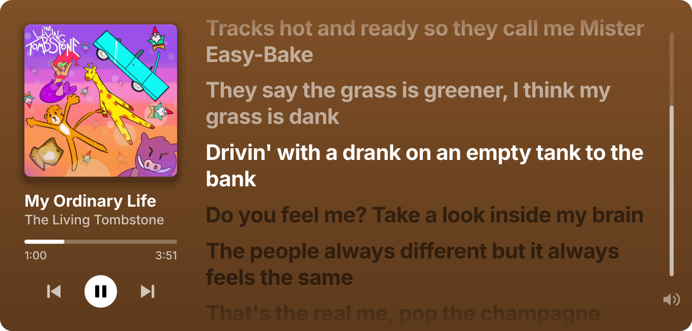
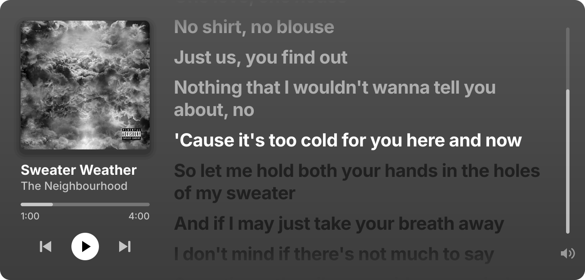
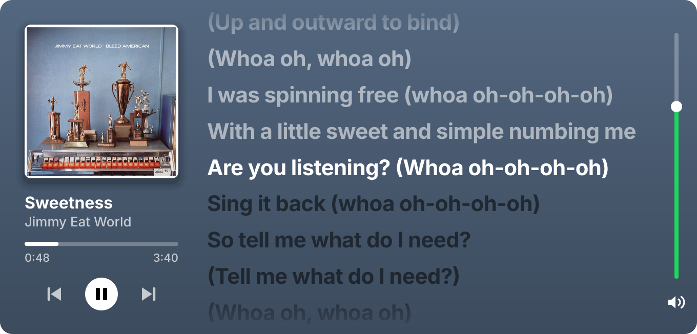
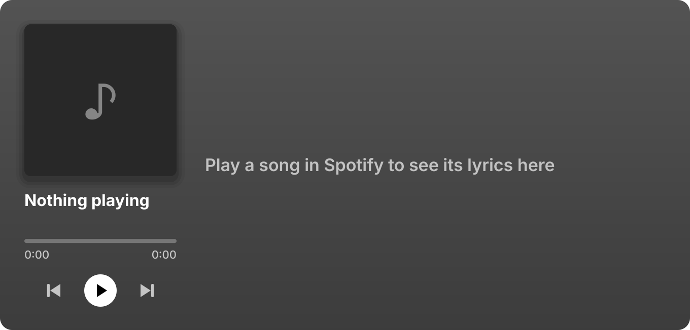
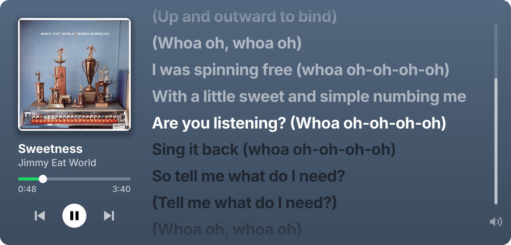
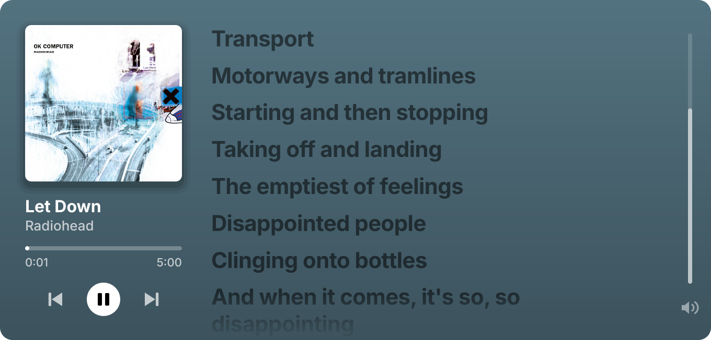

# Spotify Widget

<p align="center"></p>

The card takes its colour from each cover, and falls back to grey when the cover has none:

| | |
| --- | --- |
|  |  |
|  |  |

The volume slider lights up under the pointer, and the card says so when Spotify has nothing to play:

| | |
| --- | --- |
|  |  |

The progress bar can be dragged to any point in the song, and the first lines of a song start at the top of the card:

| | |
| --- | --- |
|  |  |

## What is this project

Spotify Widget is a small always-visible card that shows time-synced lyrics for the song playing in Spotify, next to its cover, name, artist and progress. It reads the song from Spotify through the system's media player interface, fetches matching lyrics from [lrclib.net](https://lrclib.net), and scrolls them in step with playback. The card also carries previous, play/pause and next buttons, a progress bar that seeks and a volume slider, takes its colour from the album cover, and can be dragged to any corner of any screen. It listens to Spotify only, so a video in a browser or any other player leaves it alone. It runs on Linux, Windows and macOS.

## Install

Python 3.10 or newer is required.

```bash
git clone https://github.com/heterodoxin/spotify-widget
pip install ./spotify-widget
spotify-widget
```

`pip` installs every dependency: PySide6 and requests on all systems, jeepney on Linux, and the winrt media packages on Windows. The card appears in the top left corner of the screen in use and fills in as soon as Spotify has a song.

| Command | What it does |
| --- | --- |
| `spotify-widget` | Show the card, starting the widget if it is not running |
| `spotify-widget toggle` | Hide the card if it is shown, show it otherwise |
| `spotify-widget show` / `hide` | Show or hide the card |
| `spotify-widget status` | Print whether it is running, the corner it sits in and the current song |
| `spotify-widget quit` | Stop the widget |

On the card itself: drag it to move it, click the buttons to control playback, click or drag the progress bar to jump within the song, drag the slider on the right edge or scroll anywhere on the card to change volume, and click the speaker to mute.

### Toggle key

`Ctrl` + `Super` + `L` hides and shows the card. `Super` is the Windows key on Windows and `Cmd` on macOS. The widget sets the key up itself:

| System | How the key is claimed |
| --- | --- |
| Hyprland | The widget adds the bind to the running compositor, and adds it again after a config reload |
| Windows | `RegisterHotKey` |
| macOS | A Carbon hot key, which needs no accessibility permission |
| Linux on X11 | A key grab on the root window |

A combination that is already bound in Hyprland is left alone. To use another one, set `SPOTIFY_WIDGET_HOTKEY` before starting, for example `SPOTIFY_WIDGET_HOTKEY=ctrl+alt+k`. It takes any of `ctrl`, `alt`, `shift` and `super` followed by a letter, a digit or `f1` to `f12`, and any other value such as `none` claims no key.

GNOME, KDE and other Wayland desktops do not let an app claim a key. There, bind a key to `spotify-widget toggle` in the desktop's keyboard settings.

### Hyprland

No configuration is needed with a Lua config. On start the widget gives the compositor the window rule the card needs (floating, pinned to every workspace, no blur, shadow, border or animation) under the name `spotify-widget`, and restores it after a config reload. With a classic config, add a rule with the same properties for the class `spotify-widget`; do not give it `no_focus`, which also stops the pointer from reaching the card.

## Why it's better

Measured on a Ryzen 9 9950X running Hyprland 0.56.2 with PySide6 6.11.1:

- One read of the player's state over D-Bus takes 0.3 ms, and it happens once a second. No helper program is started to do it.
- With a song playing and the card at rest, the widget uses 3.4% of one core and 96 MB of memory, averaged over 30 seconds. It redraws at up to 140 frames a second only while what it shows is changing, moves without redrawing, and drops to a 25 Hz tick otherwise.
- On Hyprland each window move is one message on the compositor's socket, which takes 0.06 ms, so dragging stays in step with the pointer.
- Lyrics and covers are cached on disk, so a song costs one request to lrclib.net the first time it plays and none after that.
- When the exact lookup finds nothing, or finds a record with only unsynced text, a second search by title and first artist picks the synced result whose length is within three seconds of the song. This recovers songs credited to several artists and songs whose album entry was never synced.
- The test suite has 50 tests covering the drag physics, lyric parsing and lookup, the choice of player, the toggle key and the card's controls. It runs without a display or a media player.

## Why should I care

- Lyrics stay on screen while you do something else, in a corner you choose, on every workspace.
- You can pause, skip, seek and change volume from the card instead of switching to the player.
- It follows Spotify and nothing else. A video in a browser, a game or another music player never replaces the song on the card, and with no Spotify song it reads "Nothing playing".
- Nothing needs configuring. There is no account, no API key and no settings file, the toggle key works out of the box, and the only thing it remembers is the corner you left it in.
- The only data that leaves the machine is the song's title, artist, album and length, sent to lrclib.net to find lyrics, plus the request for the cover image.

## Advanced

### Moving the card

The card is tied to its corner by a spring. While you hold it, it follows the pointer by three tenths of the distance at first and less the further it is pulled. Its reach is 24% of the screen's width (at most 560 px) sideways and 26% of its height (at most 360 px) up or down:

- Pulled past its reach, the card lets go of its corner and glides to the next one while the button is still down. On the side that gave, the pull is then measured from the new corner, so one drag can carry it across two corners or onto another screen.
- While held, only distance counts, so a fast jerk does not move it. On release, 0.05 seconds of the pointer's speed is added to the pull.
- On release the card keeps 35% of the pointer's speed and a damped spring carries it to its corner. A pull short of the reach returns it to the corner it came from.
- When the pointer enters another screen, the card goes to the corner of that screen nearest the pointer.

The chosen screen and corner are saved and restored on the next start. If that screen is gone, the card moves to the screen in use.

### Platforms

| System | How Spotify is read | How the card is placed | Volume |
| --- | --- | --- | --- |
| Linux on Hyprland | MPRIS over D-Bus | Native Wayland window moved through Hyprland's socket | Yes |
| Linux on other desktops | MPRIS over D-Bus | X11 or XWayland window positioned by Qt | Yes |
| Windows 10 and 11 | Spotify's session in the system media transport controls | Window positioned by Qt | No, the slider is hidden |
| macOS | AppleScript | Window positioned by Qt | Yes |

What has been run: Linux on Hyprland 0.56.2 with a Lua configuration, including the bind and window rule the widget adds, and the X11 path through XWayland on the same machine, where the key grab was tested with a synthetic key press. The Windows and macOS backends, their toggle keys and the classic (non-Lua) Hyprland syntax are written against those platforms' interfaces and have not been run on them.

On Linux the widget picks its backend from the environment. Setting `SPOTIFY_WIDGET_PLACEMENT=generic` forces the X11 path on Hyprland, and setting `QT_QPA_PLATFORM` yourself overrides the choice of Qt platform.

On macOS the first start asks for permission to control Spotify, because the song is read through AppleScript.

Wayland does not let a window choose its own position, which is why the card is moved through the compositor there. Clicking the card gives it keyboard focus, so on release the widget hands focus back to the window that had it. Hyprland moves the pointer to a window it focuses, so the widget turns `cursor:no_warps` on for that one step and then puts it back as it was.

### Which players count as Spotify

On Linux a player is read when its MPRIS name contains `spotify`, `ncspot` or `librespot`, which covers the desktop app, `spotifyd` and `spotify_player`. With several of them open, the card stays with the one it is showing while that one plays, and moves to another when it stops and the other is playing. On Windows the session whose app id contains `spotify` is read, which covers the installer build and the Microsoft Store build. Spotify playing in a browser tab is not read on any system.

### Files

| What | Linux | macOS | Windows |
| --- | --- | --- | --- |
| Lyrics and cover cache | `~/.cache/spotify-widget` | `~/Library/Caches/spotify-widget` | `%LOCALAPPDATA%\spotify-widget\cache` |
| Remembered corner | `~/.config/spotify-widget/home.json` | `~/Library/Application Support/spotify-widget/home.json` | `%APPDATA%\spotify-widget\home.json` |

The Linux paths follow `XDG_CACHE_HOME` and `XDG_CONFIG_HOME` when they are set. Deleting the cache is safe; it is rebuilt as songs play.

### Lyrics

The line being sung sits in the middle of the card. At the start and end of a song, where that would leave empty space, the lines rest against the top or bottom edge and the highlight moves through them until the middle is reached.

Only time-synced lyrics are shown. A song with none shows "No synced lyrics for this song", and a track marked instrumental shows "Instrumental". A failed lookup is not cached, so it is tried again the next time the song plays.

### Tests

```bash
pip install "./spotify-widget[test]"
cd spotify-widget
pytest
```
